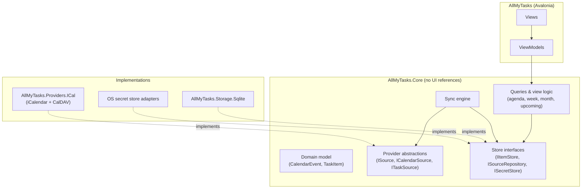
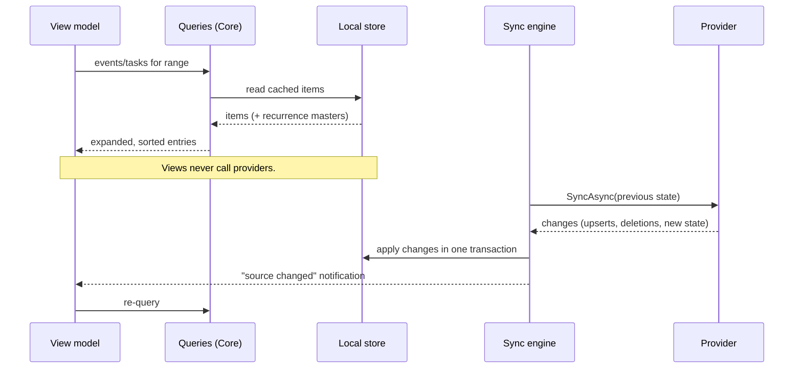

# Architecture

## Layers

The rule: **dependencies point inward**. Views know view models, view models know Core,
Core knows nothing about Avalonia, SQLite, HTTP or any specific provider.

## Projects

Today there are `AllMyTasks`, `AllMyTasks.Core` and `AllMyTasks.Core.Tests`. Planned
additions, each only when its first real content arrives:

| Project | Contents | References |
| --- | --- | --- |
| `AllMyTasks.Core` | Domain model, provider abstractions, sync engine, recurrence expansion, view logic, store interfaces | nothing app-specific |
| `AllMyTasks.Providers.ICal` | iCalendar parser wrapper, `.ics` and CalDAV clients | Core |
| `AllMyTasks.Storage.Sqlite` | SQLite store, migrations | Core |
| `AllMyTasks` | Avalonia app, composition root, secret-store adapters, view models | Core and the implementation projects |
| `tests/*` | One test project per source project | |

Providers get their own project so each one's dependencies (HTTP, parsers, vendor SDKs)
stay out of Core. Storage gets one so Core tests can run against an in-memory fake.
Splitting is cheap to do later; do not create a project before it has code.

## Data flow

Two independent loops: **reading** (UI to cache, always fast, works offline) and
**syncing** (providers to cache, slow, can fail). A failing provider never blanks a view;
it shows stale data plus a per-source status.

## Cross-cutting rules

- **Time**: Core takes a clock (`TimeProvider`) and a time zone as inputs. Nothing calls
  `DateTime.Now`. See [domain-model.md](domain-model.md#time).
- **Cancellation and async**: every I/O method takes a `CancellationToken`. Core uses
  `ConfigureAwait(false)` per `CLAUDE.md`.
- **Errors**: providers throw typed exceptions or return typed results, see
  [providers.md](providers.md#errors). The sync engine turns them into per-source status.
- **Logging**: through `ILogger`. Never log URLs with embedded credentials, tokens,
  `Authorization` headers, or event/task content at information level or above.
- **Dependency injection**: composition root in the app project using
  `Microsoft.Extensions.DependencyInjection`. Core exposes no static state.
- **Testing**: new logic lands in Core with tests. Providers are tested against recorded
  fixtures (sample `.ics` files, captured CalDAV responses) with fake data only, never
  real calendars.

## Threading

View models call Core on the UI thread and `await`; Core does its work on the thread pool
via async I/O. The sync engine runs on background tasks and raises change notifications;
view models marshal to the UI thread themselves. Core never touches `Dispatcher`.
